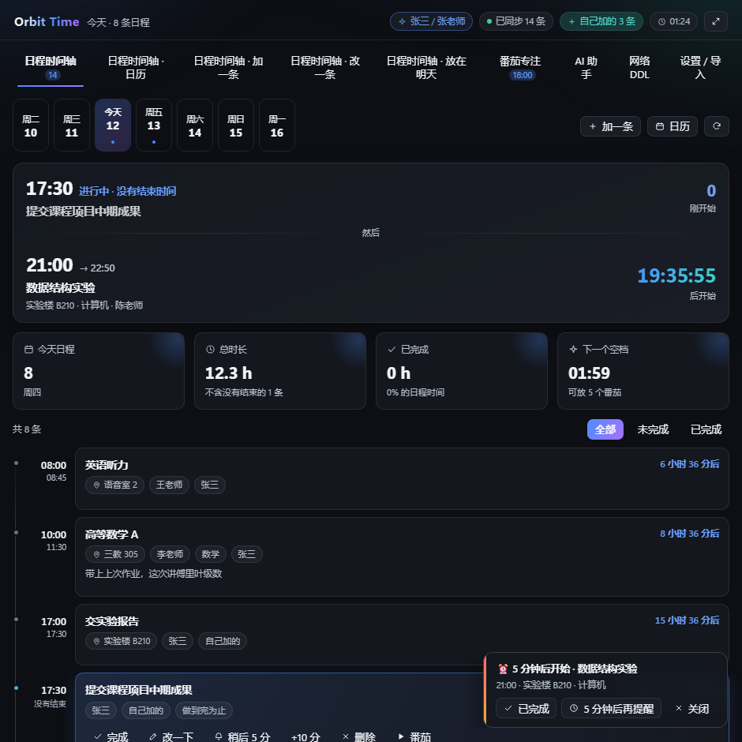
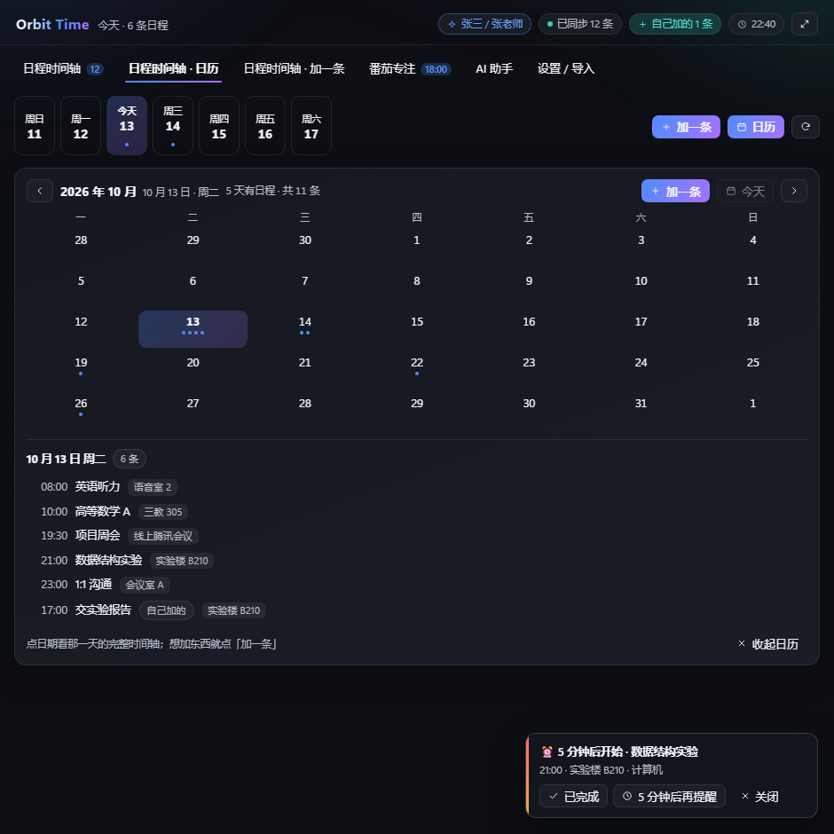
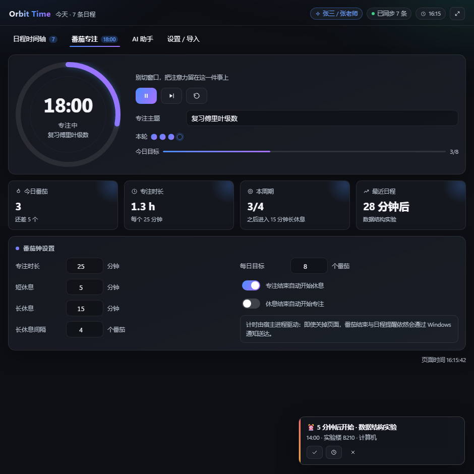
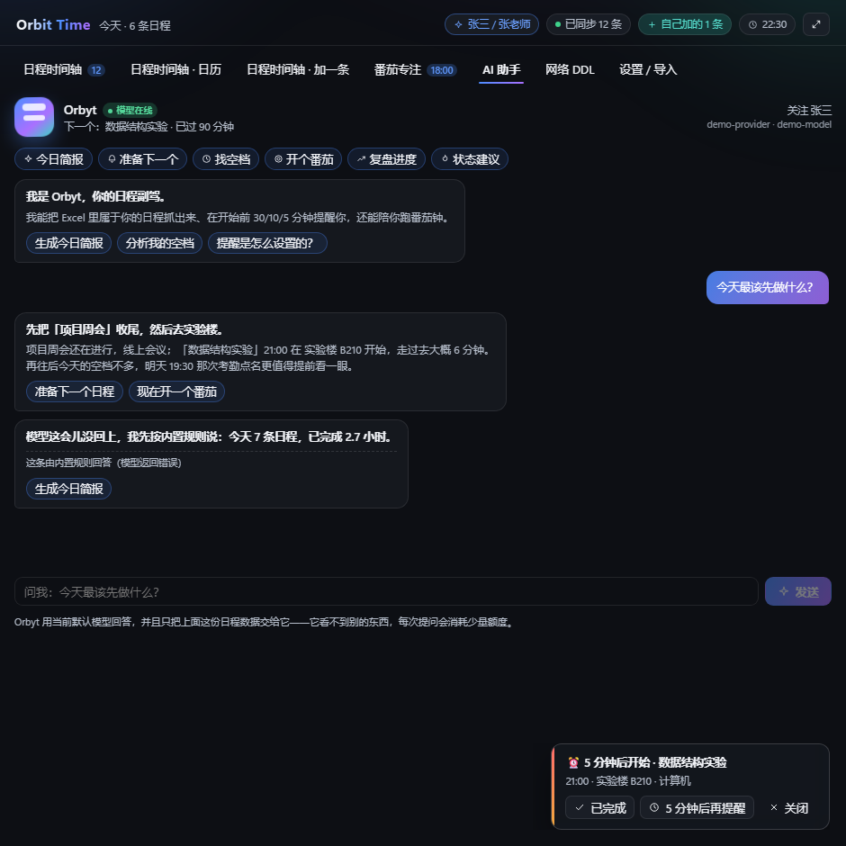
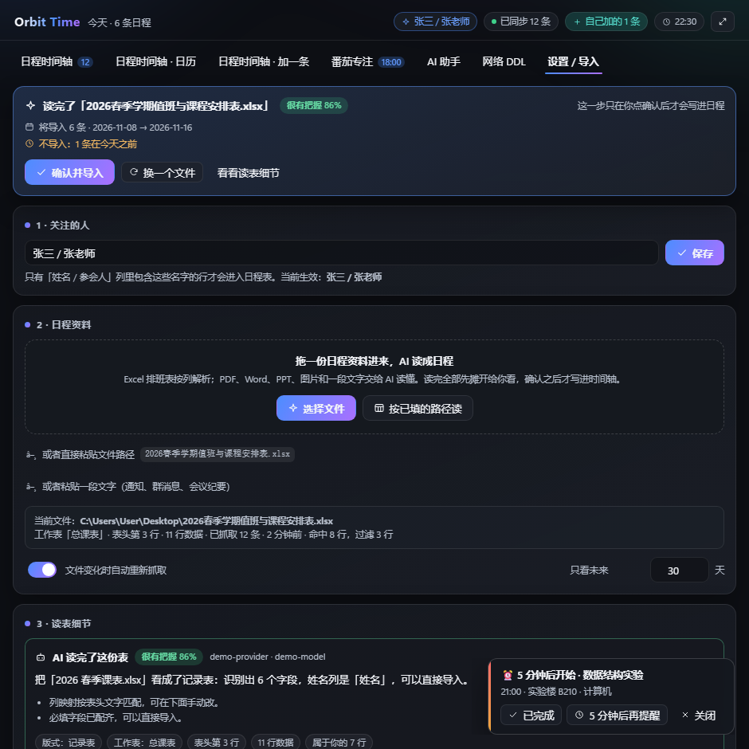
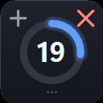

<div align="center">

# 🧭 Orbit Time

**排班表、Word 通知、课程网站 —— 把「属于你的那些事」收成一块会动的日程仪表盘**

<sub>DeepSeek Harness 插件 · Windows</sub>


</div>



<p align="center">
  <a href="#它能做什么">它能做什么</a> ·
  <a href="#快速开始">快速开始</a> ·
  <a href="#把日程放进来">四种来源</a> ·
  <a href="#提醒专注与悬浮窗">提醒与专注</a> ·
  <a href="#ai-副驾-orbyt">AI 副驾</a> ·
  <a href="#配置">配置</a> ·
  <a href="#项目结构">项目结构</a> ·
  <a href="#已知边界">边界</a>
</p>

---

## 它能做什么

| | |
| --- | --- |
| **日程时间轴** | 今天 / 本周的安排、进行中高亮、剩余时间与空档；一键完成、稍后提醒、顺延、直接开番茄 |
| **整月日历** | 一个月里哪几天有安排一眼看完，左右翻月，点日期跳到那天 |
| **读表导入** | 拖进 Excel 排班表，AI 判断版式、列映射与周次，**确认卡**摊开「导入几条、跳过几条」再入库 |
| **读文档 / 读图** | PDF、Word、PPT、截图，或直接粘一段通知；读懂后逐条勾选才写进日程 |
| **网络 DDL** | 登录一次课程网站，把「什么时候交什么」读成日程；同样勾选后才入库 |
| **加一条** | 不用 Excel、不用 AI，写一句话选个时间就进日程，导入不会把它冲掉 |
| **多段提醒** | 开始前 30 / 10 / 5 分钟 + 正好开始，共四次；页面关掉照样弹 Windows 通知 |
| **番茄专注** | 渐变圆环、呼吸光晕、周期圆点、每日目标；专注 / 短休 / 长休全套状态机 |
| **AI 副驾 Orbyt** | 模型在线时按你的真实日程回答；模型不可用时自动回落内置规则并标注原因 |
| **置顶悬浮窗** | 独立进程的真·置顶小窗，三档状态、可拖动、不占任务栏 |

## 界面

<table>
<tr>
<td width="50%"><br><sub><b>整月日历</b> —— 哪几天有安排，一眼看完</sub></td>
<td width="50%"><br><sub><b>读文档</b> —— 拖一份通知进来，先读、再勾、后入库</sub></td>
</tr>
<tr>
<td><br><sub><b>网络 DDL</b> —— 登录一次，之后点一下</sub></td>
<td><br><sub><b>番茄专注</b> —— 圆环就是开始 / 暂停</sub></td>
</tr>
<tr>
<td><br><sub><b>AI 副驾 Orbyt</b> —— 模型在线，看不到日程以外的东西</sub></td>
<td><br><sub><b>设置 / 导入</b> —— 姓名、资料、提醒、悬浮窗</sub></td>
</tr>
</table>

<table align="center">
<tr>
<td align="center"><br><sub>完整胶囊</sub></td>
<td align="center"><br><sub>最小圆点</sub></td>
</tr>
</table>

---

## 快速开始

**要求**：Windows · DeepSeek Harness 桌面端 · Edge 或 Chrome（网页 DDL 用）；Python 与 PowerShell 用 DSH 自带的，无需另装。

```bash
# 1. 构建两半，并安装进当前 profile
node build.mjs

# 2. 重启 DeepSeek Harness（首次安装必须）
```

重启后左侧边栏出现 Orbit Time 图标，点开就是仪表盘。名字、文件、提醒节奏都在 **设置 / 导入** 页里改，改完即时生效。

```bash
cd packages/orbit-time
pnpm run check-live     # 状态目录 + 悬浮窗进程，两条独立证据
pnpm run verify         # 用 profile 里的真实配置跑一遍导入，打印抓到什么
```

> **不要**用 `curl .../api/orbit-time/health` 判断插件是否加载：DSH 在路由匹配**之前**就拒绝未认证请求，
> 装了和没装都返回 401，区分不出来。

### 改完代码要不要重启

| 改了什么 | 生效方式 |
| --- | --- |
| `src/client/*`、`styles.css` | `node build.mjs` → **刷新页面** |
| `cordis.patch.yml` 条目 | 通常不用重启，HMR 会重新组合 profile |
| `src/host/read-document.py` | `node build.mjs` 后**下一次读取**就生效 |
| `lib/index.js`（宿主半） | **必须重启** |
| 首次安装 | **必须重启** |

> ⚠️ 插件条目必须写在 `insert:` 里。顶层条目是「覆盖已存在的 id」，id 不存在时只会打一行 unmatched 警告，插件永远不挂载。

---

## 把日程放进来

四种来源，出口是同一张时间轴；**只有你确认过的条目才会入库**。

### 1 · Excel 排班表

认两种版式，自动判断：

| 版式 | 长什么样 | 怎么读 |
| --- | --- | --- |
| **records** | 一行一条：日期 / 起止时间 / 事项 / 姓名 / 地点 | 按列映射 |
| **matrix** | 日历网格：表头是日期或「第N周 + 周一…」，格子里直接写名字 | 转成「谁在哪天值班」 |

- 合并单元格、`上午9:30`、Excel 序列号日期、跨行共享日期都能处理；
- 「第N周」按 `weekOneMonday` 换算成真实日期；
- 值班表没有上下班时间时，用 `timeRules` 按关键词给时间，匹配范围包括**工作表名 + 文件名 + 表外文字**（"点名时间：19:30–20:50" 这类说明会被单独读出来）；
- 姓名是**子串 + 否定词保护**：`张三、李四` 命中「张三」，`不含张三` 不会误判；
- 导入是**并集**：导入第二份，第一份还在；手动加的行也不会被冲掉。

### 2 · 文档、截图、一段话

拖进 PDF / Word / PPT / 图片，或粘贴一段文字。宿主把内容交给当前默认模型读懂，页面先列出「读到几条、跳过几条」，**勾选确认才写进日程**。

- 单次上限：40 页 / 24000 字 / 4 张页面图；
- 上传的文件存在 `~/.dsh/storages/orbit-time/uploads/`，只保留最近 10 个；
- 模型不可用时回落**本地规则**（找日期、认「截止 / due / DDL」），面板会注明原因，不会空着。

### 3 · 网络 DDL

登录一次课程网站，之后点一下就把「什么时候交什么」抓回来。

| 入口 | 说明 |
| --- | --- |
| **中国大学MOOC** | 适配器直接读个人中心的课程接口；MOOC 与 SPOC 两个页签都读 |
| **任意网页** | 贴一个能看到截止时间的页面地址；有登录表单就先填再提交 |
| **AI 智能页** | 模型规划要打开哪几页、再从页面文字与 JSON 里挑时间节点 |

- 密码只在本机，且只有密文（Windows DPAPI，绑定当前 Windows 账户）；明文只出现在子进程 stdin；
- 抓到的每一条都带原页面链接和原文证据，勾选后才入库；
- 同一批再抓一次不会重复（按「平台 + 课程 + 标题 + 时刻」去重）；
- 页面结构说变就变 —— 读空时会给出截图和原始 JSON 的路径，而不是假装「你没有作业」。

命令行等价物：

```bash
pnpm run ddl status
pnpm run ddl login --user demo@example.com --pass '…'
pnpm run ddl pull --days 120 --ics ddl.ics   # 也能导出成日历文件
```

### 4 · 随手加一条

点「加一条」写一句、选个时间就进日程。它和导入的行住在同一个地方，所以重新导入 Excel 不会把它冲掉。

---

## 提醒、专注与悬浮窗

**提醒由宿主进程驱动**，不是浏览器定时器 —— 关掉页面、切走窗口都照样触发。

| 时机 | 你会收到 |
| --- | --- |
| 开始前 30 分钟 | `🔔 30 分钟后开始 · 数据结构实验` |
| 开始前 10 分钟 | `🔔 10 分钟后开始 · …` |
| 开始前 5 分钟 | `⏰ 5 分钟后开始 · …`（红色紧急样式） |
| 正好开始 | `⏰ 现在开始 · …` |

- 每段只响一次；窗口期 5 分钟，电脑刚睡醒时漏掉的会补送，更早的静默跳过；
- 每条都能直接 **已完成** 或 **5 分钟后再提醒**；
- 夜间静音默认 `22:30 → 06:30`，节奏与静音都可在设置里改。

**番茄**：专注 25 / 短休 5 / 长休 15 分钟，每 4 轮一次长休，每日目标 8 轮；开始、暂停、跳过、重置都在圆环上。

**悬浮窗**是插件自己拉起的独立 PowerShell/WinForms 进程（DSH 桌面端不让插件创建 Electron 窗口），真正 `TopMost`：

| 状态 | 尺寸 | 上面有什么 |
| --- | --- | --- |
| 完整胶囊 | 232 × 64 | 圆环（点 = 开始/暂停）+ 倒计时 + 当前日程；— 最小化、» 打开面板、× 关闭 |
| 最小圆点 | 64 × 64 | 进度圈 + 剩余分钟；+ 展开、× 关闭、底部拖动条 |
| 关闭 | — | 进程退出，并**记住是用户关的**（重启不会再自己冒出来） |

位置与状态写在 `hud-mode.json`；右键还有 开始暂停 / 完成 / 重置 / 重读 Excel / 隐藏 等菜单。

---

## AI 副驾 Orbyt

Orbyt 有**两个脑子**，用哪个会明确标出来：

| | 模型在线（默认） | 内置规则（兜底） |
| --- | --- | --- |
| 何时使用 | DSH 里配好的默认模型可用时 | 模型被关、没装、报错、超时或返回空 |
| 看到什么 | 只有一份**日程 JSON**（今日、未定、接下来、统计、空档、番茄、提醒设置） | 同一份数据，本机计算 |
| 出错时 | 自动回落并标注原因 | — |

内置规则能回答：今日简报、准备下一个、找空档（≥20 分钟，以及能放几个番茄）、复盘进度、状态建议。

**关掉模型就完全不消耗额度**，且不影响其余功能。

---

## 安全与隐私

- 插件**不持有任何模型密钥**：调用走 DSH 自己的 `llm` 服务与默认模型，仓库里没有任何 key / token；
- 课程站密码用 **DPAPI** 加密存在本机状态目录，绑定当前 Windows 账户，换机器解不开；
- 所有 HTTP 路由在 `127.0.0.1` 上，DSH 在路由匹配前就拒绝未认证请求，并拒绝陌生 Origin；
- 交给模型的内容只有日程 JSON、你主动拖进来的文档、或你要求读取的页面文字。

---

## 配置

写在 `~/.dsh/profiles/desktop/cordis.patch.yml` 的 `orbit-time` 条目里；运行时可改的部分落到 `~/.dsh/storages/orbit-time/config.json`。

<details>
<summary><b>展开配置表</b></summary>

| 键 | 默认值 | 说明 |
| --- | --- | --- |
| `profile.name` / `profile.aliases` | `"张三"` / `[]` | 用哪些名字过滤；**留空则导入全部行** |
| `workbook.sources[]` | — | 每个源可单独给 `subject`、`note`、`timeRules`、`sheet` |
| `workbook.timeRules` | — | 按关键词（工作表名 + 文件名 + 表外文字）给网格条目配时间 |
| `workbook.subject` / `workbook.note` | `""` | 单表安装的兜底标签与说明 |
| `workbook.weekOneMonday` | `2026-08-31` | 「第 1 周」的周一，用来把周次换成真实日期 |
| `workbook.path` | `""` | 单个文件或文件夹；填了会和 `sources` 一起导入 |
| `workbook.watch` | `true` | 文件改动自动重新抓取 |
| `workbook.importHorizonDays` | `60` | 只导入未来 N 天 |
| `reminders.offsetsMinutes` | `[30,10,5,0]` | 提醒节奏（分钟），`0` = 正好开始 |
| `reminders.osToast` | `true` | 是否弹 Windows 通知 |
| `reminders.quietHours` | `22:30 → 06:30` | 静音时段 |
| `pomodoro.*` | `25 / 5 / 15 / 4 / 8` | 专注、短休、长休、长休间隔、每日目标 |
| `assistant.useModel` | `true` | Orbyt 是否用默认模型回答 |
| `assistant.maxTokens` / `timeoutMs` / `historyTurns` | `700` / `45000` / `6` | 单次上限、超时、携带历史轮数 |
| `ui.showFloatingWidget` | `true` | 宿主启动时自动拉起悬浮窗 |
| `netddl.headless` | `false` | 网页 DDL 用无窗口浏览器；默认关，登录要人 |
| `netddl.ai` | `true` | 打开 AI 智能页；关掉只走适配器与本地规则 |
| `netddl.aiMaxPages` / `aiMaxTokens` / `aiTimeoutMs` | `6` / `4096` / `120000` | 读几页、正文预算、超时 |
| `netddl.repairCode` / `repairMaxTokens` | `true` / `4096` | 修复台是否生成补丁建议（**永远不会自动应用**） |

</details>

运行态在 `~/.dsh/storages/orbit-time/runtime.json`（日程、手动覆盖、动态流）。

---

## 项目结构

<details>
<summary><b>展开目录树</b></summary>

```
dsh-orbit-time/
├── build.mjs                       一键构建 + 安装进 profile
├── samples/                        示例排班表与示例通知（txt / docx / pdf / png）
└── packages/orbit-time/
    ├── lib/                        构建产物（profile 里运行的就是它）
    │   ├── index.js                宿主半：状态、Excel 管线、提醒引擎、HTTP API、通知
    │   ├── client.js               浏览器半：由 src/client 生成，单文件 lazy-CJS
    │   ├── hud.ps1                 置顶悬浮窗（UTF-8 BOM，PowerShell 5.1 要求）
    │   ├── parse-xlsx.py           openpyxl 解析：表头识别、列映射、网格转置、姓名过滤
    │   ├── read-document.py        PDF / Word / PPT / 图片 → 文字与页面图
    │   ├── shared-repair.cjs       乱码路径修复（宿主与客户端共用同一套规则）
    │   └── netddl/                 网页 DDL 读取器
    ├── src/
    │   ├── client/                 util · ui · store · timeline · calendar · manual
    │   │                           pomodoro · companion · netddl · import-view · settings · panel
    │   ├── host/                   hud.ps1 / parse-xlsx.py / read-document.py 的源文件
    │   │   └── netddl/             cdp.js（DevTools 协议）+ parse.js（纯函数）+ index.js（编排）
    │   └── shared/
    └── scripts/                    构建、预览、验证脚本
```

</details>

客户端是**生成文件**：DSH 的浏览器模块系统按包读取一个 lazy-CJS 产物，`scripts/build-client.mjs` 把 `src/client/*.js` 包进内部注册表，既保持多文件可读，也不需要打包器。

---

## 开发

```bash
node build.mjs                 # 构建两半 + 安装
node build.mjs --no-install    # 只构建

cd packages/orbit-time
pnpm test                      # 10 套
pnpm run test:fast             # 跳过 70 秒的提醒等待
pnpm run preview -- --tab=calendar --png   # 只渲染日历那一屏
```

<details>
<summary><b>10 套测试分别覆盖什么</b></summary>

| 套件 | 覆盖 |
| --- | --- |
| `smoke-client.mjs` | 真实 React 渲染 bundle：slot 注册、样式注入、日历 42 格、翻月参数、导入确认卡 |
| `test-patch-parser.mjs` | 真实 `cordis.patch.yml`：注释、引号、嵌套、`第N周` 日期 |
| `test-state-location.mjs` | 状态目录落点、旧 temp 状态迁移、显式 `DSH_HOME` 不捡别人的状态 |
| `test-excel.mjs` | 真实 xlsx：表头识别、时间归一、合并日期、姓名过滤与否定词、表外文字、时间矛盾告警 |
| `test-labels.mjs` | 多排班表并集导入、拖文件上传副本、手动行存活、周次锚点不随日期过期 |
| `test-hud.mjs` | 真实悬浮窗：命中判断、真实点击、拖动位移、关闭持久化、损坏偏好回落 |
| `test-host.mjs` | 真实宿主 + HTTP：事件归一、完成/顺延、番茄状态机、设置深合并、提醒阶梯、模型各条失败路径 |
| `test-extract.mjs` | 文档/图片读取：路由、验证、模型关掉时的本地规则、去重、入库不重复 |
| `test-netddl-host.mjs` | 网页数据 → 日程：能力上报、12 条路由、去重、修复路由、未选课时报错而非空结果 |
| `test-netddl.mjs` | 真实 mock 课程站 + 真实浏览器：填表登录、cookie 复用、iframe 表单、AI 规划、AI 不可用回落 |

</details>

---

## 已知边界

- **悬浮窗是独立进程**：关掉 DSH 主窗口后它可能还在，点它的 × 或停掉那个 `powershell.exe`。
- **需要 PowerShell 5.1**（Windows 自带）；非 Windows 平台其余功能正常，悬浮窗会明确报错。
- **网页 DDL 依赖站点当下长什么样**：页面结构变了会读空，但会给出截图与原始 JSON 路径，而不是假装没有作业。
- **网页 DDL 需要 Edge 或 Chrome**，一个都没有时状态卡会直说。
- **验证码替不了**：滑块 / 点选 / 短信验证都留给窗口前的人。
- **网格版式靠关键字识别**：格子里是子串匹配，`张三（代）` 仍能命中；完全不同的写法需要加进 `aliases`。

---

## 许可

MIT
